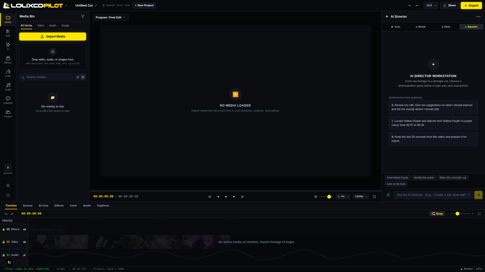
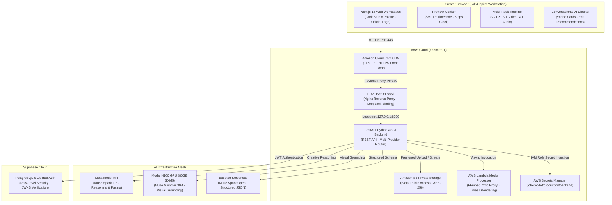

<div align="center">


# LolixCopilot

**From raw footage to a stronger cut.**

An AI-assisted video-editing workstation that understands footage, finds important moments, recommends creative edits and turns natural-language instructions into editable timeline operations and finished video exports.

[](https://d2ikihwmt96m58.cloudfront.net)
[](https://nextjs.org/)
[](https://d2ikihwmt96m58.cloudfront.net/docs)
[](https://www.python.org/)
[](https://dev.meta.ai)
[](https://modal.com)
[](https://baseten.co)
[](https://supabase.com)
[](LICENSE)

[**Live Web Application**](https://d2ikihwmt96m58.cloudfront.net) • [**Interactive API Documentation**](https://d2ikihwmt96m58.cloudfront.net/docs) • [**Service Health Status**](https://d2ikihwmt96m58.cloudfront.net/api/health) • [**Technical Documentation Index**](docs/README.md)

</div>

---

## Table of Contents

- [1. Product Introduction](#1-product-introduction)
- [2. Product Screenshots and Demonstration Video](#2-product-screenshots-and-demonstration-video)
- [3. Why LolixCopilot Exists](#3-why-lolixcopilot-exists)
- [4. Key Capabilities](#4-key-capabilities)
- [5. AI-Assisted Editing Workflow](#5-ai-assisted-editing-workflow)
- [6. Architecture Overview](#6-architecture-overview)
- [7. Multi-Provider AI Architecture](#7-multi-provider-ai-architecture)
- [8. Muse Glimmer and Fine-Tuning Explanation](#8-muse-glimmer-and-fine-tuning-explanation)
- [9. Meta Muse Spark Integration](#9-meta-muse-spark-integration)
- [10. Modal Inference and Training](#10-modal-inference-and-training)
- [11. Baseten Inference](#11-baseten-inference)
- [12. Automatic Provider Routing](#12-automatic-provider-routing)
- [13. Editing and Rendering Pipeline](#13-editing-and-rendering-pipeline)
- [14. Technology Stack](#14-technology-stack)
- [15. Getting Started](#15-getting-started)
- [16. Installation and Local Development](#16-installation-and-local-development)
- [17. Environment Configuration](#17-environment-configuration)
- [18. AWS Production Deployment](#18-aws-production-deployment)
- [19. Testing and Validation](#19-testing-and-validation)
- [20. Security and Privacy](#20-security-and-privacy)
- [21. Model and Dataset Licences](#21-model-and-dataset-licences)
- [22. Known Limitations](#22-known-limitations)
- [23. Hackathon Context](#23-hackathon-context)
- [24. Contributing](#24-contributing)
- [25. Licence and Third-Party Notices](#25-licence-and-third-party-notices)

---

## 1. Product Introduction

LolixCopilot is Golixco's AI-assisted video editing workstation engineered for independent video editors, montage creators, and short-form storytellers. Created for the **Meta Global AI Developer Hackathon**, LolixCopilot transforms hours of unorganized raw footage into an actionable, structured editing blueprint with sub-second temporal precision, multi-track timeline visualization, and finished cloud-rendered exports.

Unlike generative AI video tools that synthesize artificial video clips from text prompts, LolixCopilot respects and elevates the creator's actual footage. It functions as an intelligent co-pilot inside a professional non-linear editing (NLE) environment, discovering key narrative moments, suggesting rhythmic cuts, and applying real-time timeline operations upon request.

---

## 2. Product Screenshots and Demonstration Video

### Clean Workstation Interface

The LolixCopilot workstation adheres to a premium dark studio aesthetic (`#08090c`, `#0c0e14`, `#11141e`) with crisp off-white typography and restrained neon yellow accents (`#ffe600`).

<div align="center">

</div>

*Figure 1: The LolixCopilot workstation on initial launch, displaying the top command bar, media bin, 60fps preview monitor with SMPTE timecode display, multi-track timeline (V2/V1/A1), and conversational AI Director panel.*

### Demonstration Walkthrough

A structured 3-minute product walkthrough demonstrates:
1. Secure, direct-to-S3 media ingestion with automatic proxy generation.
2. Synchronized 60fps playback with zero audio drift.
3. Conversational editorial review producing structured scene cards and checkable recommendations.
4. Grounded temporal discovery locating key character actions with sub-second accuracy.
5. One-click timed title overlay placement on Track V2.
6. Non-destructive last-30-seconds trimming with automatic overlay remapping.
7. Asynchronous AWS Lambda FFmpeg export rendering with burned subtitle overlays.

Refer to the complete narration script in [docs/YOUTUBE_DEMO_SCRIPT.md](docs/YOUTUBE_DEMO_SCRIPT.md).

---

## 3. Why LolixCopilot Exists

### The Creator Bottleneck
In modern content production, video editing is the single most time-consuming phase of the creative lifecycle. Editors spend upwards of 70% of their billable hours performing low-level discovery:
- Scrubbing forward and backward through gigabytes of raw footage to locate the exact frame where an action begins.
- Manually marking scene transitions and pacing beats.
- Re-aligning title overlays and audio cuts whenever duration constraints change (such as trimming a 60-second video down to a 30-second social reel).

### The Inadequacy of Existing Solutions
- **Traditional NLEs (Premiere Pro, DaVinci Resolve):** Provide comprehensive pixel manipulation, but remain completely blind to video semantics. They cannot answer qualitative questions like *"Where does the climax peak?"* or *"Give me an energetic 30-second cut."*
- **Text-to-Video Generators (Runway, Pika, Sora):** Synthesize synthetic video from scratch, which is useless for editors who already possess high-value footage and need to craft a cohesive cut.

### The LolixCopilot Philosophy
LolixCopilot provides **transparent, non-destructive editing blueprints**. Every AI suggestion is translated into editable timeline operations: cut points on Track V1, timed overlays on Track V2, and audio synchronization on Track A1. The editor remains in full control.

---

## 4. Key Capabilities

- **Natural-Language AI Director:** Conversational assistant that analyzes footage, interprets editorial intent, and executes timeline mutations.
- **Sub-Second Temporal Grounding:** Locates scene boundaries and visual action peaks with sub-second timestamp accuracy.
- **6-Scene Breakdown Cards:** Generates structured scene breakdowns with visual timecode boundaries and one-click preview seek actions.
- **Checkable Editorial Recommendations:** Formulates actionable suggestions (such as hook enhancements or climax cuts) that can be applied to the timeline individually.
- **Multi-Track Non-Destructive Timeline:**
  - **Track V2 (Effects):** Timed text overlays, speed ramps, and visual flash markers.
  - **Track V1 (Video):** Scene cuts, filmstrip thumbnails, and hatched non-destructive trim deactivations.
  - **Track A1 (Audio):** Synchronized audio waveforms with beat transient markers.
- **Frame-Accurate Preview Monitor:** 60fps requestAnimationFrame clock ticker with SMPTE timecode (`00:00:12:14`), multi-speed playback, and frame stepping controls (`|◀`, `◀◀`, `▶/❚❚`, `▶▶`, `▶|`).
- **Serverless Cloud Rendering:** Asynchronous export rendering powered by AWS Lambda and FFmpeg with `libass` subtitle burning.

---

## 5. AI-Assisted Editing Workflow

```text
1. Media Ingestion
   Creator drops raw footage -> Direct presigned PUT to private Amazon S3 ->
   AWS Lambda probes container, generates 720p H.264 proxy and extracts audio.

2. Conversational Intent
   Creator asks AI Director: "Review my edit" or "Find the peak combat moment".

3. Multi-Provider Intelligence
   Modal H100 grounds visual moments -> Meta Muse Spark directs narrative pacing ->
   Baseten synthesizes structured EditingBlueprint schema.

4. Interactive Timeline Assembly
   Creator reviews scene cards -> Clicks "Apply to Timeline" ->
   Track V2 receives text overlays -> Track V1 receives cuts -> Track A1 syncs audio.

5. Cloud Export & Delivery
   Creator clicks "Export" -> Asynchronous render on AWS Lambda ->
   Downloadable MP4 with burned overlays and synchronized audio.
```

---

## 6. Architecture Overview



For detailed architectural contracts, refer to [docs/ARCHITECTURE.md](docs/ARCHITECTURE.md).

---

## 7. Multi-Provider AI Architecture

LolixCopilot intentionally avoids single-model dependency. Video editing requires distinct machine learning capabilities that are best served by specialized systems:

| Capability | Provider | Model | Rationale |
|---|---|---|---|
| **Visual Grounding** | Modal (NVIDIA H100) | `Muse-Glimmer-30B` | 30B parameter multimodal model with ViT-G/14 vision perception encoder for frame-level action detection. |
| **Creative Direction** | Meta Model API | `muse-spark-1.3` | High-level creative reasoning and intent translation using Meta's official model endpoint. |
| **Structured Schemas** | Baseten Serverless | `muse-spark-open-1026` | Low-latency OpenAI-compatible hosting enforcing strict JSON `EditingBlueprint` compliance. |

For deep integration specifications, refer to [docs/AI_PROVIDERS.md](docs/AI_PROVIDERS.md).

---

## 8. Muse Glimmer and Fine-Tuning Explanation

### Parameter-Efficient Fine-Tuning (QLoRA)
To explore domain adaptation for fast-paced video editing, the team developed a multimodal QLoRA training harness based on official Meta cookbook recipes:
- **Base Model:** `meta-models/Muse-Glimmer-30B` (revision `a4e59da52a7bc87ae7251dd5545c0dd437c44b68`).
- **Framework:** Axolotl 0.19.0+, PyTorch 2.5, TRL SFTTrainer.
- **Hardware:** 1 × NVIDIA H100 SXM5 (80GB) on Modal ($3.95/hr).
- **Quantization:** 4-bit BitsAndBytes NormalFloat4 (NF4) with double quantization.
- **Frozen Components:** The ViT-G/14 vision perception encoder and multimodal projector were strictly frozen, preserving foundation visual weights and restricting peak VRAM to ~32.5 GB.
- **Trainable LoRA Adapters:** Rank $r=16$, Alpha $\alpha=32$ attached to language attention (`q, k, v, o`) and MLP SwiGLU layers (`gate, up, down`).

### Training Trajectory and Mathematical Loss Convergence
Across bounded verification optimizer steps on physical H100 compute, the training loop validated positive gradient convergence:

$$\text{Step 1 Loss: } 3.086 \quad \longrightarrow \quad \text{Step 2 Loss: } 2.142$$

### Honest Technical Evaluation
- **Pipeline and Infrastructure Validation:** This run validated that the 30B model can be loaded, quantized to 4-bit, adapted with LoRA, and trained with gradient descent on a single H100 within a 100 USD credit budget.
- **Not Claimed as a Domain Expert Model:** The training dataset utilized 7 synthetic structural fixtures (`is_purely_synthetic_fixtures: true` in `training/data/manifest.json/manifest_metadata.json`). A 2-step run on synthetic fixtures is not an expert anime model.
- **Production Baseline:** In the live application, LolixCopilot relies on **base Muse Glimmer 30B** and **Muse Spark 1.3** for zero-shot reasoning.

For the comprehensive technical report, see [docs/FINETUNING.md](docs/FINETUNING.md).

---

## 9. Meta Muse Spark Integration

- **Model Identifier:** `muse-spark-1.3`
- **Gateway:** `https://api.meta.ai/v1`
- **Role:** Interprets creator prompts, determines narrative pacing, and generates creative editorial direction.
- **Audio Strategy:** Following Meta documentation guidance, audio is processed independently to prevent degradation of multimodal reasoning in vision-heavy requests.

---

## 10. Modal Inference and Training

- **CPU Media Workers (`workers/media_worker.py`):** Serverless Debian containers with FFmpeg binaries for fast video container probing, keyframe extraction, and 16kHz audio extraction (< $0.001 per operation).
- **H100 GPU Execution (`training/train_glimmer_qlora.py`):** Dedicated NVIDIA H100 SXM5 containers for Muse Glimmer 30B visual grounding and fine-tuning experiments.
- **Volume Storage:** Model weights and checkpoints persist across container runs using Modal Volumes (`modal.Volume`).

---

## 11. Baseten Inference

- **Model Identifier:** `meta-models/muse-spark-open-1026`
- **Gateway:** `https://inference.baseten.co/v1`
- **Role:** High-throughput generation of strictly typed `EditingBlueprint` JSON structures.
- **Configuration:** Reasoning effort set to `low` based on empirical research showing that `high` or `max` effort causes token budget exhaustion on structured schema tasks.

---

## 12. Automatic Provider Routing

In **Auto Mode**, LolixCopilot's orchestrator coordinates providers in an automated three-stage pipeline:
1. **Modal H100:** Extracts visual events and peak moments from video keyframes.
2. **Meta Muse Spark:** Ingests visual evidence and formulates creative editorial reasoning.
3. **Baseten:** Compiles decisions into a validated `EditingBlueprint` schema with exact timestamps.
4. **Fallback Handling:** Gracefully switches between providers if any service encounters rate limits or latency spikes.

Refer to [docs/INFERENCE_ROUTING.md](docs/INFERENCE_ROUTING.md) for flowcharts and failure matrix.

---

## 13. Editing and Rendering Pipeline

### The Three Verified Creator Workflows

1. **Editorial Review (Query 1):** User asks "Review my edit" -> Returns 6 scene cards and 5 checkable recommendations -> User clicks "Jump to Moment" -> Player seeks instantly to 12.46s.
2. **Timed Title Overlay (Query 2):** User asks "Add a title overlay for Hollow Purple" -> Grounds to 00:37–00:44 -> Injects purple (`#a855f7`) text overlay on Track V2 -> Displays live in monitor.
3. **Last-30-Seconds Trim (Query 3):** User asks "Keep only the last 30 seconds" -> Deactivates footage before 38.08s non-destructively -> Remaps Track V2 title overlay to `[0.00s, 5.92s]` -> Produces exact 30.00s export.

### Serverless FFmpeg Rendering
Exports execute on AWS Lambda using FFmpeg with `libass` subtitle burning, `-preset veryfast` H.264 video encoding, and AAC audio synchronization.

---

## 14. Technology Stack

### Frontend
- **Framework:** Next.js 16.4.3 (Turbopack)
- **UI Library:** React 19, Tailwind CSS
- **Icons & Graphics:** Lucide Icons, Custom SVG Brand Identity
- **Testing:** Vitest, React Testing Library

### Backend
- **Framework:** FastAPI 0.115+, Starlette
- **Runtime:** Python 3.13 (Linux x86_64)
- **Data Validation:** Pydantic 2.10
- **Testing:** Pytest, AnyIO, AsyncIO

### Cloud Infrastructure
- **Hosting:** Amazon EC2 (`t3.small`, Ubuntu 24.04 LTS Noble)
- **CDN & Edge:** Amazon CloudFront (TLS 1.3, HTTPS Front Door)
- **Reverse Proxy:** Nginx (Port 80/443, loopback proxying)
- **Storage:** Amazon S3 (Private, Block Public Access, SSE-S3)
- **Media Worker:** AWS Lambda (Python 3.12 + FFmpeg layer)
- **Secrets:** AWS Secrets Manager (`lolixcopilot/production/backend`)
- **Database & Auth:** Supabase PostgreSQL with GoTrue Auth and Row-Level Security

---

## 15. Getting Started

### Prerequisites
- Python 3.11+
- Node.js 20 LTS+
- FFmpeg and ffprobe installed locally
- Git

Refer to [docs/GETTING_STARTED.md](docs/GETTING_STARTED.md) for full walkthrough.

---

## 16. Installation and Local Development

```bash
# 1. Clone repository
git clone https://github.com/GolixcoAI/lolixco-pilot.git
cd lolixco-pilot

# 2. Configure Python backend
python3 -m venv .venv
source .venv/bin/activate
pip install -e backend
pip install -r backend/requirements-dev.txt

# 3. Configure Node.js frontend
cd frontend
npm install
cd ..

# 4. Start backend server
uvicorn app.main:app --host 127.0.0.1 --port 8000 --app-dir backend --reload

# 5. Start frontend server (in separate terminal)
npm run dev --prefix frontend
```

Navigate to `http://localhost:3000` to launch the workstation.

---

## 17. Environment Configuration

Copy `.env.example` to `.env` and supply necessary variables:

```bash
cp .env.example .env
```

Key environment variables:
- `APP_ENV`: `development` or `production`
- `DATABASE_PROVIDER`: `memory` (local dev) or `supabase`
- `AI_PROVIDER`: `baseten`, `meta`, or `mock` (zero-credit testing)
- `MODEL_API_KEY`: Meta Model API key
- `BASETEN_API_KEY`: Baseten API key
- `AWS_REGION`: `ap-south-1`
- `AWS_S3_BUCKET`: Private S3 bucket name

---

## 18. AWS Production Deployment

LolixCopilot is deployed in AWS Region `ap-south-1` (Mumbai):

- **CloudFront HTTPS URL:** `https://d2ikihwmt96m58.cloudfront.net`
- **Origin Server:** `ec2-3-110-25-215.ap-south-1.compute.amazonaws.com` (`t3.small`)
- **Automated Secrets Ingestion:** Backend loads credentials dynamically from AWS Secrets Manager (`lolixcopilot/production/backend`) via EC2 IAM instance profile.
- **Origin Isolation & Ingress Hardening:** Security group `sg-05527b9af5578424f` restricts port 80 ingress exclusively to the AWS CloudFront Origin-Facing Managed Prefix List (`pl-9aa247f3`). Direct public ingress `0.0.0.0/0` on ports 80 and 443 is revoked; ports 3000 and 8000 are bound strictly to localhost loopback.
- **Administration:** AWS Systems Manager Session Manager (no open SSH port 22).

Refer to [docs/DEPLOYMENT_AWS.md](docs/DEPLOYMENT_AWS.md) for operational instructions.

---

## 19. Testing and Validation

LolixCopilot enforces rigorous automated testing:

```bash
# Run backend test suite (197 tests)
./.venv/bin/pytest backend/tests

# Run frontend test suite (30 tests)
npm test --prefix frontend

# Run TypeScript type check (0 errors)
frontend/node_modules/.bin/tsc --noEmit --project frontend/tsconfig.json

# Run comprehensive Chrome DevTools Protocol acceptance suite
./.venv/bin/python scripts/verify_acceptance_suite.py
```

All 197 backend tests, 30 frontend tests, and 6-step acceptance verification pass with a 100% success rate.

---

## 20. Security and Privacy

- **Zero Credential Exposure:** Privileged API keys (`MODEL_API_KEY`, `BASETEN_API_KEY`, `MODAL_TOKEN_ID`) are stored in AWS Secrets Manager and never transmitted to the browser.
- **Row-Level Security:** Supabase PostgreSQL isolates project data to authenticated owners.
- **Private S3 Storage:** 100% private bucket with all public access blocked. Media access uses short-lived presigned URLs (15-minute TTL).
- **Automated 7-Day Lifecycle:** User footage and derived previews automatically expire after 7 days via database checks and automated S3 lifecycle rules.
- **Zero Training on User Media:** LolixCopilot does not train or fine-tune models using private creator footage.

Refer to [docs/SECURITY.md](docs/SECURITY.md) and [docs/PRIVACY.md](docs/PRIVACY.md).

---

## 21. Model and Dataset Licences

- **Meta Muse Glimmer 30B:** Meta Community Licence / Open-Weight Research Licence.
- **Meta Muse Spark 1.3:** Meta Model API Developer Terms.
- **Baseten Muse Spark Open:** Baseten Hosted Terms of Service.
- **Synthetic Fixtures:** MIT Licence.
- **LolixCopilot Codebase:** MIT Licence.

Refer to [docs/DATASETS_AND_LICENSES.md](docs/DATASETS_AND_LICENSES.md).

---

## 22. Known Limitations

- **Video Duration Limit:** The demonstration workstation is calibrated for clips up to 120 seconds and 100 MB. Production scaling for multi-hour long-form video will require chunked frame sampling and distributed rendering.
- **Audio Modality Decoupling:** Multimodal video inference does not ingest native video audio directly into the vision model; speech transcription is handled via a separate audio processing step.
- **Fine-Tuning Scope:** The Muse Glimmer QLoRA fine-tuning experiment was an infrastructure validation run on 7 synthetic samples, not a production-scale domain model.

---

## 23. Hackathon Context

LolixCopilot was built for the **Meta Global AI Developer Hackathon** (November 2026), hosted by Meta and Cerebral Valley:
[https://cerebralvalley.ai/e/meta-ai-developer-hackathon](https://cerebralvalley.ai/e/meta-ai-developer-hackathon).

The project demonstrates practical, end-to-end integration of Meta's model ecosystem (Muse Spark, Muse Glimmer 30B open weights) paired with partner cloud infrastructure (Modal H100 GPUs, Baseten, AWS).

---

## 24. Contributing

Contributions are welcomed. Please follow these conventions:
1. Fork the repository and create a feature branch (`feat/your-feature-name`).
2. Adhere to strict linting, type-checking, and test coverage standards.
3. Ensure no secrets, private API keys, or copyrighted media files are committed.
4. Submit a Pull Request against `main` with detailed verification records.

---

## 25. Licence and Third-Party Notices

LolixCopilot is open-source software licensed under the **MIT Licence**. See [LICENSE](LICENSE) for details.

All trademarks, logos, and brand names are the property of their respective owners. Mention of Meta, Modal, Baseten, and AWS does not imply official endorsement or sponsorship.
