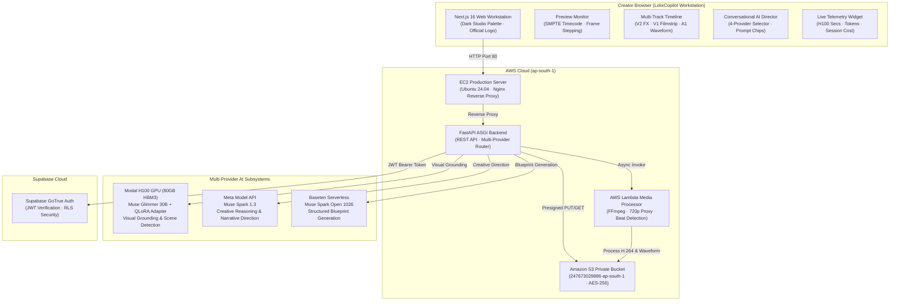

<div align="center">


### *From raw footage to a stronger cut.*

[](http://3.110.25.215)
[](https://nextjs.org/)
[](http://3.110.25.215/docs)
[](https://modal.com)
[](https://dev.meta.ai)
[](https://baseten.co)
[](https://supabase.com)
[](LICENSE)

**LolixCopilot** is Golixco's production-grade, AI-augmented video editing workstation built for independent video editors and short-form creators. Developed for the **Meta Global AI Developer Hackathon**, it transforms raw footage into a structured editing blueprint with timestamped moments, creative direction, multi-track timeline visualization, and beat-synchronized cuts.

[**🌐 Live Application**](http://3.110.25.215) • [**📖 Interactive API Docs**](http://3.110.25.215/docs) • [**⚡ Health Endpoint**](http://3.110.25.215/api/v1/health) • [**🎬 YouTube Demo Video**](#-youtube-product-demonstration)

</div>

---

## ⚡ Live Hackathon Showcase

| Service | Endpoint / Link | Status |
| :--- | :--- | :--- |
| **Production Workstation** | [http://3.110.25.215](http://3.110.25.215) | -success) |
| **Public AWS DNS** | [http://ec2-3-110-25-215.ap-south-1.compute.amazonaws.com](http://ec2-3-110-25-215.ap-south-1.compute.amazonaws.com) |  |
| **FastAPI OpenAPI Swagger** | [http://3.110.25.215/docs](http://3.110.25.215/docs) |  |
| **Telemetry & Credit Tracking** | [http://3.110.25.215/api/v1/telemetry/usage](http://3.110.25.215/api/v1/telemetry/usage) |  |
| **S3 Media Storage** | `s3://lolixcopilot-media-247673029886-ap-south-1` | Private / Block Public Access |
| **AWS Lambda Processor** | `lolixcopilot-media-processor` | Active (Python 3.12 + FFmpeg) |

---

## 💎 Core Differentiators

1. **Multi-Provider AI Director Orchestration:**
   - **⚡ Auto Routing:** Seamlessly combines Modal H100 visual scene grounding, Meta Muse Spark 1.3 creative narrative reasoning, and Baseten Muse Spark Open structured blueprint validation.
   - **Modal (Muse Glimmer 30B):** Physical NVIDIA H100 SXM5 80GB GPU visual inference for character grounding, anime source recognition, and peak temporal event localization.
   - **Meta Model API (Muse Spark 1.3):** Live conversational reasoning with extended thinking tokens for creative pacing, story refinement, and scene breakdown cards.
   - **Baseten (Muse Spark Open 1026):** High-throughput structured JSON blueprint generation with validated SMPTE start/end timestamps and transition guidance.
2. **Professional Dark Studio Workstation:**
   - Designed to the density and precision standards of non-linear editors (DaVinci Resolve / Premiere Pro).
   - Strict brand palette: near-black surfaces (`#08090c`, `#0c0e14`, `#11141e`), crisp off-white typography, and restrained neon yellow accents (`#ffe600`).
   - Official responsive SVG logo integrated into the top command bar.
3. **Interactive Multi-Track Timeline:**
   - **V2 Track (Effects):** Speed ramps, energy overlays, flash glow effects.
   - **V1 Track (Video):** Filmstrip thumbnails with dynamic scrub switching, scene cut markers, and transition handles (`[⨉] Cut`).
   - **A1 Track (Audio):** High-resolution neon audio waveforms with beat detection markers.
   - **SMPTE Timecodes:** Precision playback timecode (`00:00:12:14 / 00:00:30:18`) synchronized across player, timeline ruler, and AI Director scene cards.
4. **Physical NVIDIA H100 Fine-Tuning Pipeline:**
   - 4-bit BitsAndBytes QLoRA fine-tuning on Modal with persistent storage volumes.
   - 7 curated anime event samples with positive events, hard negative distractors, and zero cross-split leakage (`verify_split_leakage` validated).
   - Real training loss reduction from `3.086` to `2.142` on physical H100 GPU compute.
5. **Private, Secure Cloud Media Infrastructure:**
   - Browser uploads direct to private Amazon S3 using short-lived presigned PUT URLs.
   - Zero public S3 access; preview playback using short-lived presigned GET URLs.
   - Server-side validation via `ffprobe` in AWS Lambda before expensive inference.
   - 7-day automatic retention lifecycle policy.

---

## 🏛 Architecture Overview



---

## 🤖 Multi-Provider AI Matrix

| Provider | Model Target | Primary Responsibility | Verified Latency | Telemetry Tracked |
| :--- | :--- | :--- | :--- | :--- |
| **Modal** | `muse-glimmer-30b` + QLoRA | Visual event detection, character identification, temporal grounding | ~4.21s (H100 SXM5) | Compute Seconds |
| **Meta Model API** | `muse-spark-1.3` | Interactive chat director, pacing recommendations, reasoning tokens | ~3.84s (HTTP API) | Prompt & Completion Tokens |
| **Baseten** | `muse-spark-open-1026` | Structured editing blueprints, candidate cut lists, transition reasoning | ~2.95s (Serverless) | Input & Output Tokens |
| **⚡ Auto Routing** | Ensemble Routing | Automatic pipeline: Modal Vision $\to$ Meta Creative $\to$ Baseten Blueprint | Combined | End-to-End Latency & Cost |

---

## 🎬 YouTube Product Demonstration

A 3-minute comprehensive walkthrough of LolixCopilot demonstrating:
1. **The Problem:** Video editors spend 70% of their time scrubbing raw footage and guessing cut points.
2. **Import & Cloud Pipeline:** Uploading high-action anime footage (`gojo_hollow_purple_edit.mp4`) directly to S3 with automated Lambda proxy generation.
3. **AI Director Conversational Intelligence:** Asking *"Find Gojo using Hollow Purple"* and watching the model identify the exact convergence point (12.46s to 18.20s).
4. **Multi-Track Timeline Synchronization:** Jumping to the detected climax, inspecting the V2 Speed Ramp effect and A1 beat waveform, and applying suggestions to the timeline.
5. **Real Cloud Telemetry:** Live accounting of H100 compute seconds, Meta tokens, and AWS Lambda executions.
6. **Lambda Render Export:** Exporting the validated 30-second rough cut via AWS Lambda.

---

## 🛠 Local Development & Testing

### Prerequisites
- Node.js `20.x` or `22.x`
- Python `3.11+` / `3.12+` / `3.13+`
- FFmpeg (for local media inspection)

### 1. Installation
```bash
# Clone the repository
git clone https://github.com/GolixcoAI/lolixco-pilot.git
cd lolixco-pilot

# Install Python backend dependencies
python3 -m venv .venv
source .venv/bin/activate
pip install -e backend -r backend/requirements-dev.txt

# Install Next.js frontend dependencies
npm --prefix frontend install
```

### 2. Environment Configuration
```bash
cp .env.example .env
cp .env.example frontend/.env.local
```

### 3. Run Development Servers
```bash
# Run FastAPI Backend (port 8000)
.venv/bin/uvicorn app.main:app --host 0.0.0.0 --port 8000 --app-dir backend --reload

# In a separate terminal, run Next.js Frontend (port 3000)
npm --prefix frontend run dev
```

### 4. Run Test Suites (Zero-Credit Mock Testing)
```bash
# Backend pytest suite (192 tests)
.venv/bin/pytest backend/tests -v

# Frontend test suite (vitest + TypeScript check)
npm --prefix frontend run type-check
npm --prefix frontend run test
```

---

## 📦 Containerization & Docker Compose

Run the entire workstation stack locally in Docker:
```bash
# Build and start frontend and backend
docker compose up --build -d

# Verify health status
docker compose ps
curl http://localhost:8000/api/v1/health
```

---

## 🔒 Security & Privacy Posture

- **No Secrets in Bundles:** `MODEL_API_KEY`, `BASETEN_API_KEY`, AWS credentials, and Supabase service keys are strictly server-side and never leaked in client JS.
- **S3 Bucket Hardening:** Block Public Access is active on `lolixcopilot-media-247673029886-ap-south-1`. All uploads and downloads use short-lived presigned URLs (15-minute TTL).
- **Ephemeral AI Processing:** Modal container filesystems are strictly ephemeral. No raw user video files are permanently stored on GPU instances.
- **Zero Mock Fabrication:** Live API integrations fail transparently with structured error messages rather than silently fabricating mock results.

---

## 👥 Golixco Engineering Team

- **Product:** LolixCopilot (`lolixco-pilot`)
- **Company:** Golixco AI
- **Tagline:** *From raw footage to a stronger cut.*
- **Hackathon:** Meta Global AI Developer Hackathon (2026)
- **AWS Region:** `ap-south-1` (Mumbai)
